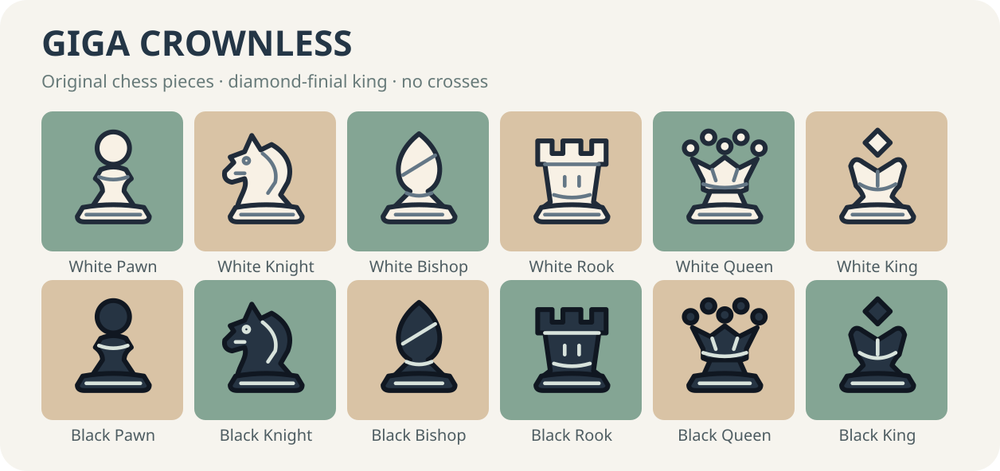

# Giga Crownless — original GigaBoard chess pieces

An original, contemporary Staunton-inspired image piece set. It is inspired by the
legibility of tournament Staunton pieces, broad outlines of Kosal-style sets, and
the clean on-screen contrast of modern digital chess pieces. **No source vectors
from Chess.com, FIDE, Lichess or Kosal were copied.**



## Design choices

- **King:** diamond-shaped finial, flared arched crown; absolutely no cross.
- **Queen:** five pearl-like jewels and a broad coronet; unmistakable at small sizes.
- **Knight:** curved mane, ear and restrained facial details.
- **Bishop:** tapered mitre with diagonal engraving.
- **Rook:** three battlements and strong architectural geometry.
- **Pawn:** generous spherical head, rounded collar and sturdy base.
- **All:** consistent lower bases; ivory/dark-slate fills, dark contours, engraved highlights.

## Use

```tsx
import { gigaCrownless } from "gigaboard/pieces/giga-crownless";
<Chessboard game={game} pieces={gigaCrownless} />;
```

The optional renderer pre-generates 12 SVG data URLs only when imported.
There are no network requests, raster dependencies, or new rendering components.
Both interactive Chessboard and StaticChessboard accept the same renderer.
Consumers with restrictive CSP must permit `img-src data:`.

For raw SVG markup call `gigaCrownlessSvg("K", "w")` from the subpath.
SVG assets are design-source vectors, not a TTF/OTF font: GigaBoard uses
`` piece renderers rather than text glyphs.

## Review checklist

- Verify all 12 pieces at 24, 32, 48 and 64 CSS pixels on green, brown, and high-contrast boards.
- Confirm white and black piece outlines remain distinct from both square colors.
- Verify light/dark mode, SSR, keyboard movement and reduced motion are unchanged.
- Run `bun run typecheck`, `bun run build`, `bun run test`, `bun run size`.
