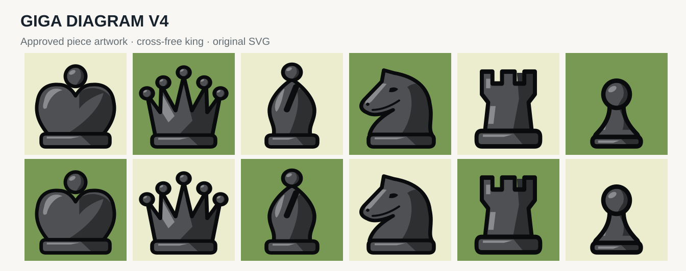

# Giga Diagram V4 — GigaBoard chess diagrams



**Approved V4 design**: ivory and charcoal, broad flat symbolic silhouettes,
heavy dark contours, restrained faceted shading, equal white/black geometry,
cross-free king with an orb, and queen without interior diamond.

Art direction: compact on-screen diagrams; Chess.com Neo-like relative piece
proportions; original vector geometry, not copied from third-party SVG paths.

## Integration

```tsx
import { Chessboard, useChessGame } from "gigaboard";
import { gigaDiagram } from "gigaboard/pieces/giga-diagram";
const game = useChessGame();
<Chessboard game={game} pieces={gigaDiagram} />;
```

The renderer uses `createImagePieceSet`, precomputes 12 SVG data URLs once,
and never fetches the piece images from the network. Individual raw SVGs
are in `packages/react/src/pieces/svg/giga-diagram/` and copied into
`dist/pieces-svg/giga-diagram/` during build for reuse.

``gigaDiagramSvg("K", "w")`` returns the white king's SVG text.
Consumers using strict CSP need `img-src data:`.

For visual regression, compare at 24, 32 and 64px across light and
dark board squares; white and black must always have byte-identical
geometry when their SVG palette/style and metadata are removed.
